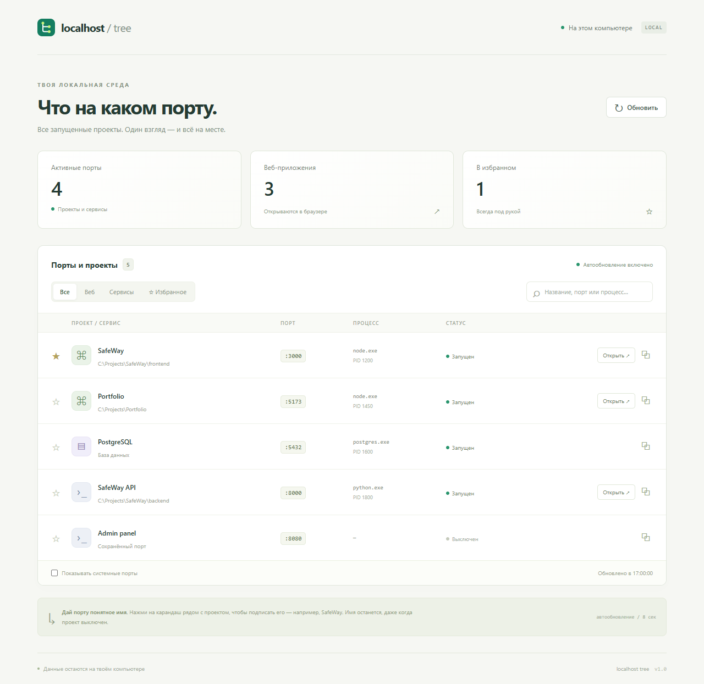
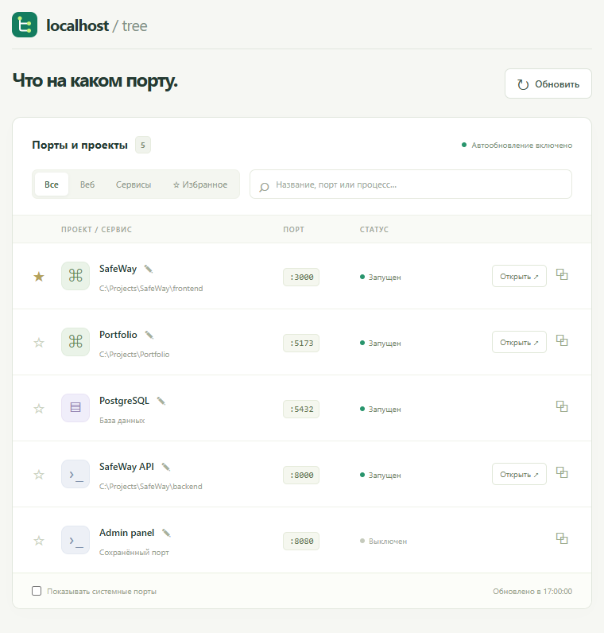

# Localhost Tree

**Что запущено на `localhost` и какой проект занимает каждый порт — в одном окне.**

Localhost Tree — локальная панель и компактный виджет для Windows. Она показывает слушающие TCP-порты, процессы и папки проектов, определяет названия веб-приложений и позволяет открыть их в браузере.

Например: `localhost:3000 → SafeWay`, `localhost:8000 → backend`, `localhost:5432 → PostgreSQL`.

Приложение написано на Node.js и обычных HTML, CSS и JavaScript. Для запуска не нужны npm-зависимости, сборка, Docker или аккаунт в облаке.



*На скриншотах используются демонстрационные данные.*

## Содержание

- [Возможности](#возможности)
- [Требования](#требования)
- [Быстрый старт](#быстрый-старт)
- [Способы запуска](#способы-запуска)
- [Как пользоваться](#как-пользоваться)
- [Настройки и хранение данных](#настройки-и-хранение-данных)
- [Как это работает](#как-это-работает)
- [Частые вопросы](#частые-вопросы)
- [Локальность и ограничения](#локальность-и-ограничения)
- [API](#api)
- [Разработка и проверка](#разработка-и-проверка)
- [Структура проекта](#структура-проекта)

## Возможности

- Реальные слушающие TCP-порты Windows, включая IPv4 и IPv6.
- Название приложения из HTML-заголовка, пути проекта или имени процесса.
- Процесс, PID и папка проекта, когда эти данные доступны.
- Открытие HTTP-приложения в браузере и копирование адреса.
- Ручные подписи: например, `3000 → SafeWay`.
- Избранное с закреплением портов вверху списка.
- Сохранённые порты со статусом «Выключен» после остановки проекта.
- Поиск по названию, порту, процессу, PID и папке проекта.
- Фильтры «Все», «Веб», «Сервисы» и «Избранное».
- Переключатель системных портов, которые по умолчанию скрыты.
- Автообновление каждые 8 секунд, пока вкладка видна.
- Компактное отдельное окно через Microsoft Edge.
- Адаптивный интерфейс на русском языке.

## Требования

| Компонент | Требование |
| --- | --- |
| Операционная система | Windows с Windows PowerShell и командой `Get-NetTCPConnection` |
| Node.js | Версия 20 или новее; разработка и проверка выполнялись на Node.js 22 |
| Системные службы | Доступ к CIM / WMI для получения информации о процессах |
| Браузер | Современный браузер; Microsoft Edge для отдельного окна виджета |
| Git | Нужен для клонирования; можно скачать ZIP через GitHub |

Начни с запуска от обычного пользователя. Для некоторых чужих или системных процессов Windows может не предоставить командную строку, поэтому их папку проекта определить не получится.

## Быстрый старт

В PowerShell:

```powershell
git clone https://github.com/iwbhappy/localhosttree.git
cd localhosttree
node server.mjs
```

Открой **<http://127.0.0.1:7341>**.

`npm install` не требуется. Вместо `node server.mjs` также можно выполнить `npm start`.

Если репозиторий приватный, для клонирования нужен доступ к нему и авторизация GitHub. При установленном GitHub CLI можно использовать `gh repo clone iwbhappy/localhosttree`.

## Способы запуска

| Способ | Что произойдёт |
| --- | --- |
| Двойной щелчок по `Open.vbs` | Сервер запустится в фоне, панель откроется в браузере по умолчанию |
| Двойной щелчок по `Widget.vbs` | Сервер запустится в фоне, компактная панель откроется отдельным окном Edge |
| `npm start` или `node server.mjs` | Сервер будет работать в текущем терминале; страницу нужно открыть самостоятельно |
| PowerShell-скрипт с `-NoBrowser` | Запустится только фоновый сервер |

Скрипты запуска проверяют `/api/health` и переиспользуют уже работающий экземпляр на выбранном порту.

### Отдельное окно виджета

```powershell
powershell -NoProfile -ExecutionPolicy Bypass -File .\Start-LocalhostTree.ps1 -Widget
```



Виджет — отдельное окно браузера в режиме приложения. Он не закрепляется поверх других окон и не добавляется в системный трей. Если Edge не найден в стандартных папках, скрипт откроет обычный браузер.

Компактный интерфейс доступен и по адресу <http://127.0.0.1:7341/?widget=1>.

### Запуск без открытия браузера

```powershell
powershell -NoProfile -ExecutionPolicy Bypass -File .\Start-LocalhostTree.ps1 -NoBrowser
```

### Остановка

- Если сервер работает в терминале после `npm start` или `node server.mjs`, нажми **Ctrl+C**.
- Если сервер запущен в фоне, открой диспетчер задач, вкладку «Подробности», включи столбец «Командная строка» и заверши именно процесс `node.exe`, запускающий файл `localhosttree\server.mjs`.

Закрытие вкладки или окна виджета оставляет фоновый сервер работающим. Автозапуск Windows скрипты не добавляют.

## Как пользоваться

1. Запусти свои проекты привычным способом: например, через `npm run dev`, Python или IDE.
2. Открой Localhost Tree. Порты появятся после сканирования.
3. Нажми **«Открыть»** рядом с обнаруженным HTTP-приложением.
4. Нажми **карандаш** рядом с названием, чтобы задать понятную подпись. Пустое поле возвращает автоматическое название.
5. Нажми **звёздочку**, чтобы добавить порт в избранное и закрепить его в начале списка.
6. Используй поиск и фильтры; при необходимости включи **«Показывать системные порты»**.

Подписанные и избранные порты остаются в списке после остановки процесса со статусом «Выключен». Порт без подписи и без звёздочки исчезает после остановки.

В фильтр «Веб» попадают порты с обнаруженным HTTP-ответом и ссылкой. Сюда может попасть и API-бэкенд. Остальные порты, включая базы данных и сохранённые выключенные порты, доступны в фильтре «Сервисы».

**Статус «Запущен» означает, что у порта есть слушающий процесс.** Он не гарантирует работоспособность всех функций приложения. Например, HTTP 404 тоже подтверждает наличие HTTP-сервера.

## Настройки и хранение данных

### Порт самой панели

По умолчанию сервер использует `127.0.0.1:7341`. Чтобы выбрать другой порт, задай переменную окружения перед запуском:

```powershell
$env:LOCALHOST_TREE_PORT = '7342'
node server.mjs
```

Для виджета с другим портом:

```powershell
$env:LOCALHOST_TREE_PORT = '7342'
powershell -NoProfile -ExecutionPolicy Bypass -File .\Start-LocalhostTree.ps1 -Widget
```

Переменная действует в текущем терминале и запущенных из него процессах. Двойной щелчок по VBS-файлу из Проводника не наследует переменную, заданную только в терминале.

Допустимы номера от `1024` до `65535`. Изменение порта не останавливает экземпляр, ранее запущенный на другом порту.

### Подписи и избранное

Настройки создаются автоматически в `data/ports.json`, например:

```json
{
  "3000": {
    "name": "SafeWay",
    "favorite": true
  }
}
```

Подпись привязана к **номеру порта**. Если на `3000` запустить другой проект, ручное название сохранится. Очисти подпись через карандаш, чтобы вернуть автоматическое определение.

Чтобы убрать выключенный порт из списка, очисти его подпись и сними звёздочку. Каталог `data/` исключён из Git. Для переноса настроек на другой компьютер можно отдельно скопировать `data/ports.json` при остановленном сервере.

Переключатель системных портов сохраняется отдельно в `localStorage` браузера; у разных браузеров и адресов панели эта настройка может отличаться.

## Как это работает

1. Node.js запускает `scripts/scan.ps1` без видимого окна PowerShell.
2. `Get-NetTCPConnection` собирает слушающие TCP-порты, а `Get-CimInstance Win32_Process` — сведения о процессах.
3. Приложение сопоставляет порты и PID, объединяя адреса одного процесса на одном порту.
4. По командной строке процесса и его родителей определяется папка проекта. В частности, распознаются пути с `node_modules`, `.venv` и `venv`.
5. Для предполагаемых веб-сервисов выполняется HTTP GET `/`. Из HTML извлекается `<title>`, а при наличии HTTP-ответа появляется ссылка «Открыть».
6. К результатам применяются сохранённые названия и избранное.

Ручная подпись имеет приоритет над автоматическим названием. Автоматическое название выбирается из заголовка страницы, папки проекта, известного назначения порта или имени процесса. Определение проекта и типа сервиса использует эвристики и может потребовать ручной корректировки.

Снимок портов кешируется на 4 секунды, результаты HTTP-проверки — на 30 секунд при ответе и на 10 секунд при неудаче. Вкладка запрашивает данные каждые 8 секунд, пока она видна; после возвращения к вкладке запускается обновление. Поэтому кнопка «Обновить» не всегда вызывает новое системное сканирование немедленно.

## Частые вопросы

### Почему `localhost:3000` открывается в браузере, а порта нет в панели?

Браузер может показывать сохранённую оболочку приложения через **Service Worker** или кеш, даже когда сервер уже остановлен. Интерфейс виден, но запросы к API завершаются ошибкой — например, появляется «Нет связи с сервером».

Localhost Tree показывает слушающие порты операционной системы. Сохранённая страница сама по себе не означает, что порт открыт или что `npm run dev` запущен.

Для проверки открой адрес в приватном окне без сохранённых данных сайта. Проверить слушающий процесс можно и в PowerShell:

```powershell
Get-NetTCPConnection -State Listen -LocalPort 3000 -ErrorAction SilentlyContinue
```

Если записей нет, Windows в этот момент не сообщает о слушающем TCP-процессе на порту `3000`.

### Почему не видно нужный сервис?

Включи «Показывать системные порты» и сбрось поиск и фильтры. Неизвестный процесс может попасть в скрытую системную группу. Убедись, что приложение запущено на этом компьютере и слушает TCP-порт.

### Почему название неправильное или показано только имя процесса?

У страницы может быть общий заголовок, а командная строка процесса может быть недоступна или не содержать папку проекта. Укажи название вручную через карандаш. Если порт занят новым проектом, проверь, не осталась ли старая ручная подпись.

### Почему рядом с портом нет кнопки «Открыть»?

Для этого порта не обнаружен HTTP-ответ. Это нормально для PostgreSQL, Redis и других протоколов. Также приложение может использовать только HTTPS, не попасть в эвристики веб-проверки или отвечать дольше установленного тайм-аута.

### Порт `7341` уже занят

Используй `LOCALHOST_TREE_PORT` либо проверь, не запущен ли уже Localhost Tree. Скрипты запуска переиспользуют существующий экземпляр; прямой повторный запуск `node server.mjs` сообщает о занятом порте.

### PowerShell блокирует `npm.ps1` или скрипт запуска

Запусти сервер напрямую:

```powershell
node server.mjs
```

Для скрипта запуска можно использовать приведённую выше команду с `-ExecutionPolicy Bypass`; она задаёт режим для отдельного процесса PowerShell. VBS-файлы уже вызывают скрипт таким способом. Если Windows Script Host отключён, используй терминал.

### Панель сообщает об ошибке сканирования

Проверь доступность системных команд:

```powershell
Get-NetTCPConnection -State Listen
Get-CimInstance Win32_Process | Select-Object -First 5 ProcessId, Name
```

Для диагностики запусти `node server.mjs` в терминале: ошибки сервера выводятся туда. Если экземпляр уже работает в фоне на том же порту, сначала останови его или выбери другой порт.

## Локальность и ограничения

- Сервер панели привязывается только к `127.0.0.1`; в приложении есть проверка `Host` и `Origin`.
- Внешние API, телеметрия, CDN и облачное хранение в приложении не используются.
- Для определения веб-приложений выполняются HTTP-запросы к адресам локальных слушающих сервисов. Это обычные GET `/` без перехода по редиректам.
- Командные строки процессов обрабатываются сервером локально и не передаются в браузер. В интерфейс передаются найденные папки проектов, имена процессов и PID.
- Панель не запускает и не останавливает обнаруженные проекты, не меняет firewall и не добавляет автозапуск.
- Отображаются **слушающие TCP-порты**. UDP, исходящие соединения и история всех ранее запущенных процессов не отображаются.
- Привязка сервиса к сетевому интерфейсу не доказывает его доступность из интернета: это зависит от firewall, маршрутизации и других настроек.
- HTTP-проверка не поддерживает HTTPS-only сервисы и не является полноценной проверкой работоспособности приложения.
- Порты внутри Docker, WSL или виртуальных машин видны только тогда, когда Windows предоставляет соответствующий слушающий порт. Отдельного опроса этих сред нет.
- Linux и macOS текущим системным сканером не поддерживаются.

## API

API доступно на том же локальном адресе, что и интерфейс.

| Метод | Путь | Назначение |
| --- | --- | --- |
| `GET` | `/api/health` | Проверка сервера; возвращает `app` и `port` |
| `GET` | `/api/ports` | Список портов, время снимка `updatedAt` и интервал `refreshMs` |
| `POST` | `/api/ports/:port` | Изменение подписи `name` и/или флага `favorite` |

Пример сохранения подписи:

```powershell
$body = @{ name = 'SafeWay'; favorite = $true } | ConvertTo-Json
Invoke-RestMethod `
  -Uri 'http://127.0.0.1:7341/api/ports/3000' `
  -Method Post `
  -ContentType 'application/json' `
  -Body $body
```

`name` — строка длиной до 100 символов, `favorite` — логическое значение. Неуказанное поле сохраняет прежнее значение. Пустое имя и `favorite: false` удаляют запись из сохранённых настроек. API также позволяет заранее подписать ещё не запущенный порт.

## Разработка и проверка

```powershell
npm test
```

Используется встроенный тестовый раннер Node.js. Тесты проверяют:

- определение проектов по путям Node.js и Python, включая пробелы;
- поиск проекта по родительским процессам и обработку циклов;
- HTTP-проверку, извлечение заголовка и IPv6;
- реальное сканирование Windows и исключение порта самого экземпляра панели;
- сохранение подписей и избранного, а также выключенные порты;
- валидацию запросов и проверки `Host` / `Origin`.

Интеграционный тест создаёт временную копию приложения и временные HTTP-серверы, затем удаляет их. Основной файл `data/ports.json` он не изменяет. Во время проверки эти кратковременные процессы могут появиться в уже открытой панели. Для полного набора тестов нужна Windows с доступными системными командами и IPv6 loopback.

Сборки нет: после правок серверных файлов перезапусти Node.js, после правок интерфейса обнови страницу.

## Структура проекта

```text
localhosttree/
├── server.mjs                # HTTP-сервер, API, кеш и сохранение настроек
├── lib/
│   └── discovery.mjs         # Определение проектов и HTTP-проверка портов
├── scripts/
│   └── scan.ps1              # Сбор TCP-портов и процессов Windows
├── public/
│   ├── index.html           # Интерфейс панели
│   ├── app.js               # Фильтры, поиск, подписи и автообновление
│   ├── style.css            # Основной, адаптивный и компактный интерфейс
│   └── icon.svg             # Иконка приложения
├── test/
│   ├── api.test.mjs         # Интеграционная проверка API и Windows-сканера
│   └── discovery.test.mjs   # Проверки определения проектов и HTTP
├── docs/images/             # Демонстрационные скриншоты
├── data/                    # Локальные данные; не включены в Git
├── Open.vbs                 # Запуск панели в браузере
├── Widget.vbs               # Запуск отдельного окна
├── Start-LocalhostTree.ps1   # Общий скрипт запуска
├── package.json
└── README.md
```
